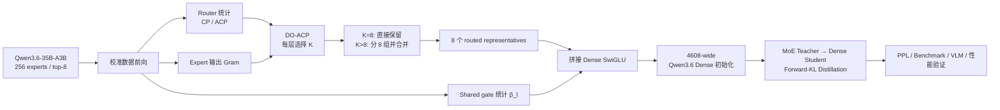
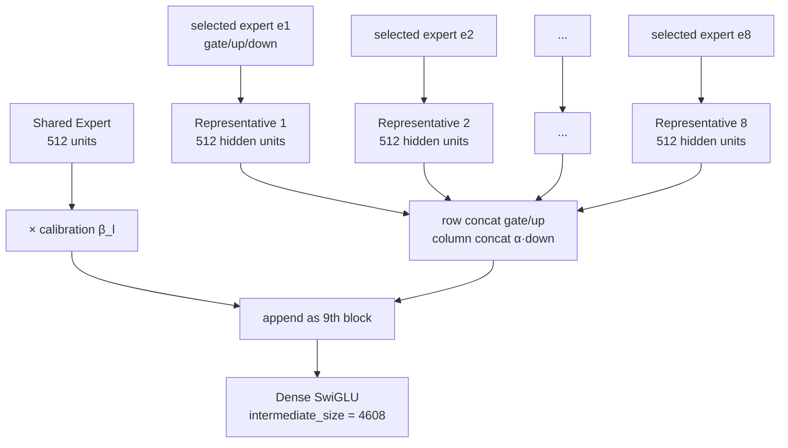
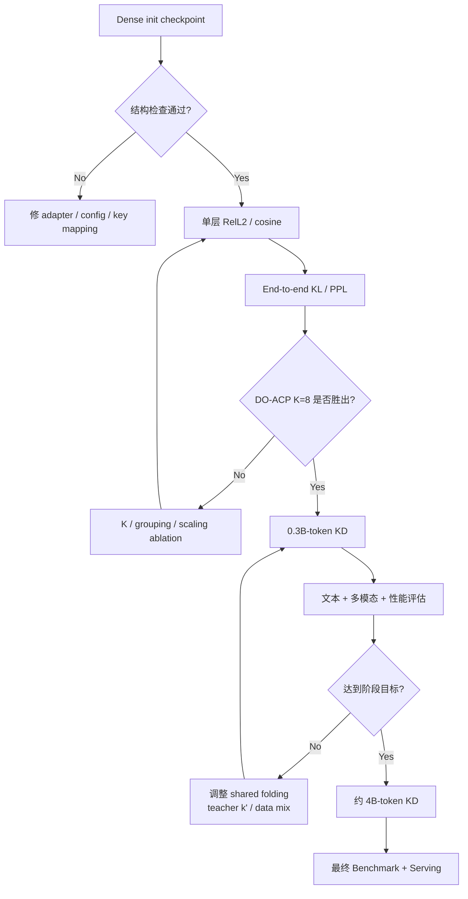

# 将 Qwen3.6-35B-A3B 的 MoE 压缩为 Dense 模型：基于 MoE-to-Dense 论文与 KRAFTON 实现的技术方案

## 执行摘要

**结论：这件事可行，但 `Qwen/Qwen3.6-35B-A3B` 不能直接套用 `krafton-ai/moe-to-dense` 当前的 Qwen3 路径。** 论文的方法本身与 Qwen3.6 的 routed experts 高度兼容：对每层专家做数据驱动评分，选出 \(K\ge k\) 个专家；当 \(K>k\) 时分成 \(k\) 组并做加权合并；最后把 \(k\) 个代表专家沿 FFN 中间维拼接成一个普通 dense SwiGLU FFN，再用原始 MoE 教师做 forward-KL 蒸馏。论文在 Qwen3-30B-A3B 上使用 \(E=128,k=8,d_{\text{expert}}=768\)，并发现 **D-Optimal + ACP（DO-ACP）、尤其 \(K=k\) 的纯专家裁剪，是最值得优先尝试的配置**；约 4B-token 蒸馏后，它相对论文的 dense-to-dense 基线提高约 6.3 个百分点，并报告了约 1.6× 的训练速度优势。citeturn14view3turn2view1

但 Qwen3.6-35B-A3B 与论文主实验模型存在四个决定性的实现差异。它实际使用 Transformers 的 `qwen3_5_moe` 架构：40 个语言层、hidden size 2048、256 个 routed experts、每 token top-8、单个 expert intermediate size 512；此外**每层还有一个 512 维 shared expert，而且这个 shared expert 不是简单的 always-on expert，而是经过一个 token-dependent sigmoid gate 后再加到 routed-expert 输出上**。同时其 routed expert 参数是两个 batched tensor——`experts.gate_up_proj[E,2m,d]` 和 `experts.down_proj[E,d,m]`——而不是 KRAFTON Qwen3 adapter 假定的 `experts.{e}.gate_proj/up_proj/down_proj` 独立模块。citeturn9view0turn14view0turn14view1

更重要的是，KRAFTON 当前 `Qwen3Adapter` 会把未知 Qwen 风格模型默认识别成 Qwen3；其 MoE 棾测默认要求 `.mlp.gate` 自身是 `nn.Linear`，而 Qwen3.6 的 `.mlp.gate` 是 `Qwen3_5MoeTopKRouter`；其 merger 又硬编码 `model.layers.{l}.mlp.experts.{e}.{proj}.weight`，而 Qwen3.6 权重前缀是 `model.language_model.layers...` 且 experts 为 fused/batched tensor。更危险的是，Qwen3 adapter 的 dense-config 逻辑会把 `layer_types` 全部改成 `full_attention`，而 Qwen3.6 本来是 linear-attention/full-attention 混合架构。**所以直接运行仓库现有 Qwen3 命令不是“效果可能差”，而是架构级不兼容。** citeturn17view0turn18view0turn19view4turn13view4turn14view2

我的建议是把项目拆成两个目标：

| 目标 | 结构 | 推荐程度 | 说明 |
|---|---|---:|---|
| **A：router-free dense language core** | 8×512 routed dense FFN + 原 shared-expert sigmoid branch | **最高，先做** | 删除 256-way router 与稀疏 experts；保留 shared gate，质量风险最低，但严格说每层仍有两条 dense FFN branch |
| **B：严格单一标准 Dense FFN** | 9×512 = **4608-wide SwiGLU** | **最终目标** | 把 8 个 routed representatives 和 shared expert 一起拼成一个 FFN；shared gate 用校准统计折叠成静态系数，再依赖蒸馏恢复 |
| C：只做 routed \(8\times512=4096\)，删除 shared branch | 4096-wide SwiGLU | 不推荐 | 参数最少，但无谓丢掉每层 shared expert 的能力 |

论文也明确说明，静态 dense FFN 无法一般性地精确复现 token-dependent routing。因此最终结果应定义为**结构上真正 dense、函数上经初始化近似并由蒸馏恢复**，而不是逐输入严格等价。Qwen3.6 的 shared sigmoid gate 又增加了一层同样无法被固定权重精确吸收的动态性。citeturn3view1turn14view1

基于 Hugging Face checkpoint 的总 tensor payload、模型配置和 expert tensor 形状，可以估计：Qwen3.6 的 40 层 routed expert 参数约为 **32.21B**；将其替换为 8 个 512-wide representatives 后 routed dense FFN 约 **1.007B** 参数。如果把 shared expert 一并折叠，dense FFN 宽度为 **4608**，40 层 FFN 参数约 **1.132B**。以 HF checkpoint 的约 71.9 GB BF16 payload 作基准，最终完整多模态 dense checkpoint 大约是 **4.7B 参数、约 9.5 GB BF16 权重**量级；这是由公开 tensor size 和配置做出的工程估算，不是 Qwen 官方发布的模型规格。citeturn8view0turn9view0turn13view4



## 架构核验、目标定义与必要假设

### Qwen3.6-35B-A3B 确实是 MoE，而且比论文中的 Qwen3 MoE 更复杂

Hugging Face 配置显示，该 checkpoint 的顶层 architecture 为 `Qwen3_5MoeForConditionalGeneration`，`text_config.model_type` 为 `qwen3_5_moe_text`。语言模型共有 40 层，`hidden_size=2048`、`num_experts=256`、`num_experts_per_tok=8`、`moe_intermediate_size=512`、`shared_expert_intermediate_size=512`；`layer_types` 保留 Qwen3.6 的 hybrid linear/full-attention pattern，同时还有 `mtp_num_hidden_layers=1`。因此转换只能替换每层 MoE FFN，**attention、linear-attention、RMSNorm、embedding、vision tower、MTP 相关结构都应原样保留。** citeturn9view0turn14view2

Transformers 实现进一步确认其专家数学形式。routed experts 保存为：

\[
W_{gu}\in\mathbb{R}^{E\times2m\times d},
\qquad
W_d\in\mathbb{R}^{E\times d\times m},
\]

其中 \(E=256,m=512,d=2048\)。对 expert \(e\)：

\[
[g_e(x),u_e(x)]
=
W_{gu}^{(e)}x,
\]

\[
f_e(x)
=
W_d^{(e)}
\left[
\operatorname{SiLU}(g_e(x))\odot u_e(x)
\right].
\]

官方实现正是先对 `gate_up_proj[e]` 做 linear，再 `.chunk(2, dim=-1)`，经过激活与逐元素乘法，再应用 `down_proj[e]`。citeturn14view0

Router 则先对全部 256 个专家做 softmax：

\[
p_e(x)
=
\frac{\exp(r_e^\top x)}
{\sum_j \exp(r_j^\top x)},
\]

取 top-8 后，再在这八个值内部重新归一化：

\[
q_e(x)
=
\frac{p_e(x)}
{\sum_{j\in S(x)}p_j(x)},
\qquad e\in S(x),
\]

最终 routed branch 为：

\[
F_{\text{routed}}(x)
=
\sum_{e\in S(x)}q_e(x)f_e(x).
\]

这与 Transformers 当前的 `Qwen3_5MoeTopKRouter` 和 `Qwen3_5MoeExperts.forward` 一致。citeturn14view1

但 Qwen3.6 还额外计算：

\[
F_{\text{shared}}(x)
=
\sigma(w_s^\top x)f_s(x),
\]

因此整层 MoE FFN 输出为：

\[
F_{\text{MoE}}(x)
=
F_{\text{routed}}(x)
+
\sigma(w_s^\top x)f_s(x).
\]

官方实现明确先运行 `shared_expert`，再以 `sigmoid(shared_expert_gate(x))` 相乘，最后加到 routed expert 输出。citeturn14view1

这意味着论文针对 DeepSeek “always-on shared expert”的简单处理不能一字不改地移植到这里。论文确实指出，有 shared experts 时 dense-equivalent width 应包含它们；例如 DeepSeek-V2-Lite 的 2 个 shared + 6 routed experts 对应 8 个 expert widths。但 Qwen3.6 的 shared branch 多了数据依赖 gate，因此将它并入一个普通 FFN时必须做额外近似。citeturn14view3

### Dense 的宽度应该是多少

对 routed branch，论文定义：

\[
d_{\text{dense,routed}}
=
k\,d_{\text{expert}}.
\]

Qwen3.6 因此是：

\[
8\times512=4096.
\]

如果保留 shared branch，则 routed dense FFN 是 4096-wide，旁边继续保留一个 512-wide gated shared MLP。

如果目标是**真正单一标准 FFN**，则我建议：

\[
d_{\text{dense,total}}
=
(8+1)\times512
=
\boxed{4608}.
\]

这里最后一个 512 block 由 shared expert 提供。其动态 sigmoid gate 用校准数据上的层级均值

\[
\beta_l
=
\mathbb E_{x\sim D_{\mathrm{cal}}}
\left[
\sigma(w_{s,l}^{\top}x)
\right]
\]

近似，然后把

\[
W_{\text{down,shared}}
\leftarrow
\beta_l W_{\text{down,shared}}
\]

再作为第九个 block 拼到 dense down projection 中。这一步是针对 Qwen3.6 的新增工程近似，而不是论文已经验证过的步骤；因此必须在后续蒸馏和 ablation 中单独验证。Qwen3.6 的动态 shared gate 形式来自官方实现。citeturn14view1

### 参数量与存储估算

由公开配置和官方 tensor shape，可以直接算 routed expert 权重：

\[
256\times
(2dm+dm)
=
256\times3\times2048\times512
=
805{,}306{,}368
\]

参数/层，40 层约：

\[
32.2123\text{B}.
\]

而 4608-wide dense SwiGLU 每层只有：

\[
3\times2048\times4608
=
28{,}311{,}552
\]

参数，40 层约：

\[
1.1325\text{B}.
\]

HF 文件索引给出的整个原始 checkpoint tensor payload 约为 71.9 GB，并把每个 logical tensor 映射到某一 safetensors shard；公开文件树包含 26 个 safetensors shard。citeturn8view0turn13view4

在“BF16 tensor payload 约 2 bytes/param”的近似下：

| 项目 | 估算参数 |
|---|---:|
| 原 checkpoint | ≈35.95B |
| 其中 40 层 routed experts | ≈32.21B |
| 40 层 router | ≈0.021B |
| routed-only dense FFN，宽 4096 | ≈1.007B |
| routed + shared 单 FFN，宽 4608 | ≈1.132B |
| 最终完整模型 | **≈4.73B** |
| 最终 BF16 tensor payload | **≈9.45 GB** |

这里的约 4.73B 包括未修改的 vision、embedding、attention/linear-attention、norm、LM head/MTP 等部分，因此它明显大于单纯计算 40 层 dense FFN 得到的 1.13B。这一数值是根据 Hugging Face checkpoint 总大小和公开配置推算，不应当作为官方参数声明。citeturn9view0turn13view4

## 论文方法到 Qwen3.6 的逐步映射

### 专家评分

论文比较了七种 expert scoring 方法，并认为**scoring 是整个转换流程中最重要的设计选择**。KRAFTON 仓库的名称映射如下。citeturn14view4

| 论文 | KRAFTON identifier | Qwen3.6 所需统计 | 适用性 |
|---|---|---|---|
| SF | `selection_freq` | 每 expert 被 top-8 选中的次数 | 很容易 |
| PP | `preselect_prob` | 256-way softmax \(p_e\) | 很容易 |
| PS | `postselect_prob` | top-8 后重新归一化 \(q_e\) | 很容易 |
| CP | `conditional_prob` | 被选中 token 上的平均概率 | **推荐 cheap baseline** |
| ACP | `reap` | CP × expert-output activation norm | **推荐** |
| DO-CP | `gram_logdet` | CP + expert output Gram | 强但更贵 |
| DO-ACP | `gld_reap` | ACP + expert output Gram | **首选** |

论文定义 router probability \(p_l^e(t)\) 与 top-\(k\) set \(S_l(t)\)，CP 只在 expert 实际入选的 token 上累计其概率；ACP 再结合 expert output magnitude，因而同时考虑路由重要性与实际函数输出强度。D-Optimal 方法进一步用 expert outputs 的 Gram matrix 描述冗余关系，从而避免仅凭单专家分数选出一批彼此高度相似的 experts。citeturn4view0turn4view2

令校准 token 的 expert function output 为 \(f_e(t)\)，经验 Gram matrix：

\[
G_{ij}
=
\mathbb E_t
\left[
f_i(t)^\top f_j(t)
\right].
\]

若 importance 为 \(I_e\)，论文构造 importance-weighted kernel：

\[
\mathcal K_{ij}
=
\sqrt{I_i I_j}\,G_{ij}.
\]

然后选：

\[
S^\star
=
\arg\max_{|S|=K}
\log\det
\left(
\mathcal K_S+\lambda I
\right).
\]

正则项使用由 Gram diagonal scale 派生的 \(\lambda\)，并用 greedy Schur-complement 方法完成 subset selection。论文将这种选择视为同时奖励专家“重要性”和“互补性”。citeturn4view2turn3view2

**对于 Qwen3.6，我会首先跑两条线：**

`CP, K=8` 用于快速检查整个转换代码是否正确；

`DO-ACP, K=8` 作为主要实验。

理由不是“8 一定对 Qwen3.6 最优”，而是论文在 Qwen3-30B-A3B 上观察到 \(K=k\) 的 pure pruning 非常强，而且 \(K=k\) 时完全不需要专家参数平均，从而绕过 MoE-to-dense 中最脆弱的非线性 weight-merging 近似。citeturn14view3turn2view1

### 选择与合并

论文先选 top-\(K\)，其中 \(K\ge k=8\)。

当：

\[
K=k=8
\]

时，每个 selected expert 自成一组：

\[
G_g=\{e_g\}.
\]

**不做任何 expert weight averaging。**

当：

\[
K>8
\]

时，需要把 \(K\) 个专家分成八组。每组代表 expert 的三套权重分别按 importance 加权：

\[
\bar W_{\mathrm{gate}}^{(g)}
=
\sum_{e\in G_g}
\frac{s_e}{\sum_{j\in G_g}s_j}
W_{\mathrm{gate}}^{(e)},
\]

\[
\bar W_{\mathrm{up}}^{(g)}
=
\sum_{e\in G_g}
\frac{s_e}{\sum_{j\in G_g}s_j}
W_{\mathrm{up}}^{(e)},
\]

\[
\bar W_{\mathrm{down}}^{(g)}
=
\sum_{e\in G_g}
\frac{s_e}{\sum_{j\in G_g}s_j}
W_{\mathrm{down}}^{(e)}.
\]

这正是论文的 grouped score-weighted averaging。citeturn3view1

需要强调：SwiGLU 是非线性的，所以

\[
f_{\operatorname{avg}(W)}(x)
\neq
\operatorname{avg}(f_W(x))
\]

一般成立。论文附录也专门讨论了“function-output weighted merge”与实际 parameter averaging 的差异。因此 \(K>k\) 的 parameter merge 天生只是 proxy，而 \(K=k\) 的 singleton expert 则不存在这个误差源。citeturn4view4

KRAFTON 实现支持五类 grouping。citeturn14view4turn5view2

| 方法 | 含义 | 对 Qwen3.6 的建议 |
|---|---|---|
| Round-robin | 按 score 排序后循环分组 | 简单基线 |
| Weight clustering | 按 expert weights cosine 聚类 | 需适配 fused tensor |
| Router clustering | 按 router row vector 相似度聚类 | 很适合 Qwen3.6 |
| Anchor-based | 高分 experts 作为 anchors，其余按 router similarity 归属 | **K>8 时优先** |
| Output clustering | 用 empirical output cosine/Gram 聚类 | 有 Gram 时优先比较 |

### Dense 拼接

对八个 group representatives：

\[
W_{\text{gate}}^{D}
=
\operatorname{cat}_{\text{row}}
\left(
\bar W_{\text{gate}}^{(1)},\dots,
\bar W_{\text{gate}}^{(8)}
\right)
\]

\[
W_{\text{up}}^{D}
=
\operatorname{cat}_{\text{row}}
\left(
\bar W_{\text{up}}^{(1)},\dots,
\bar W_{\text{up}}^{(8)}
\right)
\]

\[
W_{\text{down}}^{D}
=
\operatorname{cat}_{\text{column}}
\left(
\alpha_1\bar W_{\text{down}}^{(1)},\dots,
\alpha_8\bar W_{\text{down}}^{(8)}
\right).
\]

得到：

\[
W_{\text{gate}}^D,W_{\text{up}}^D
\in\mathbb R^{4096\times2048},
\]

\[
W_{\text{down}}^D
\in\mathbb R^{2048\times4096}.
\]

论文提出两种 static down-projection scale：

\[
\alpha_g=\frac1k
\]

或 proportional：

\[
\alpha_g
=
\frac{\sum_{e\in G_g}s_e}
{\sum_{e\in S}s_e}.
\]

二者都是用固定系数逼近原先 token-dependent router weights。citeturn3view1turn5view3

如果严格折叠 Qwen3.6 shared expert，再扩展：

\[
W_{\text{gate}}^{D,\mathrm{full}}
=
\operatorname{cat}
\left(
W_{\text{gate}}^D,
W_{\text{gate,shared}}
\right)
\in\mathbb R^{4608\times2048},
\]

对应 up projection 同理，而 down：

\[
W_{\text{down}}^{D,\mathrm{full}}
=
\operatorname{cat}
\left(
W_{\text{down}}^D,
\beta_l W_{\text{down,shared}}
\right)
\in\mathbb R^{2048\times4608}.
\]



### 知识蒸馏

论文最终用原始 MoE 作为 teacher，对 dense student 做 forward KL：

\[
\mathcal L_{\mathrm{KD}}
=
D_{\mathrm{KL}}
\left(
p_T(\cdot|x)
\;\|\;
p_S(\cdot|x)
\right).
\]

论文的实验显示 forward KL 比其比较的 reverse-KL/intermediate-feature 方案更可靠。论文还允许在蒸馏期间把 teacher 的 routing 从 \(k=8\) 临时扩大到 \(k'=16\)，并在其 Qwen3 实验上观察到约 +0.70pp 的收益；代价是 teacher 每 token 激活更多 experts。citeturn3view3turn3view4turn2view1

Qwen3.6 Router 实现把 `top_k` 存为成员字段，因此在工程上可以为 distillation teacher 设置 `gate.top_k=16`，随后仍会对选中的 16 个概率重新归一化；但这属于对论文 expanded-routing 思路的 Qwen3.6 移植，需要先做小规模验证。citeturn14view1

论文的小规模蒸馏配置是 512 条 WikiText-103、2048-token 校准；蒸馏使用 FineWeb-Edu、sequence length 4096、global batch 384、AdamW \((0.9,0.95)\)、初始 LR \(10^{-4}\)、约 200 steps ≈0.3B tokens。论文记录该阶段在 4×H200 140GB 上约 5.5 小时；它的长蒸馏实验约为 4B tokens。citeturn3view4turn5view4turn5view5

同样的 global batch 和 context 下：

\[
384\times4096
=
1{,}572{,}864
\]

tokens/step，

因此 4B-token run 大约需要：

\[
4\times10^9/1{,}572{,}864
\approx2543
\]

steps。这个计算也解释了仓库示例为什么会出现数千 step 的蒸馏配置。仓库提供了 DeepSpeed/ModelOpt 的完整蒸馏入口。citeturn6view2turn14view4

## 工程实施方案与兼容性改造

### 为什么现有 KRAFTON Qwen3Adapter 不能直接用

这是整个项目最容易踩坑的地方。

| 项目 | KRAFTON Qwen3 假设 | Qwen3.6 实际情况 | 后果 |
|---|---|---|---|
| Router module | `.mlp.gate` 且默认检测为 `nn.Linear` | `.mlp.gate` 是 `Qwen3_5MoeTopKRouter` | 默认 discovery 可能找不到层 |
| experts | `experts.{e}.gate_proj/up_proj/down_proj` | `experts.gate_up_proj[E,2m,d]` + `experts.down_proj[E,d,m]` | merger 直接失败 |
| checkpoint prefix | `model.layers...` | `model.language_model.layers...` | key 全部错位 |
| shared expert | Qwen3 adapter 当作无 shared expert | `shared_expert` + `shared_expert_gate` | 会遗漏重要分支 |
| attention layer type | adapter dense 化时设为全 `full_attention` | Qwen3.6 混合 linear/full attention | **会破坏模型架构** |
| outer architecture | Qwen3 causal LM | `Qwen3_5MoeForConditionalGeneration`，含视觉部分 | 不能简单换一个 LLM config |

这些差异可以直接从 KRAFTON adapter/merger 与 Transformers Qwen3.6 实现交叉确认。citeturn17view2turn18view0turn19view4turn14view0turn14view2turn13view4

因此建议新增：

```text
Qwen36MoeAdapter
```

而不是修改原 `Qwen3Adapter` 的行为。

adapter 至少要实现：

```python
class Qwen36MoeAdapter:
    prefix = "model.language_model.layers"

    num_experts = 256
    top_k = 8
    expert_intermediate = 512
    shared_intermediate = 512

    def find_moe_layers(self, model):
        # 找 Qwen3_5MoeSparseMoeBlock，而不是要求 gate 是 nn.Linear
        ...

    def routed_weights(self, state, layer):
        # [E, 2m, d]
        gu = state[f"{self.prefix}.{layer}.mlp.experts.gate_up_proj"]

        # [E, d, m]
        down = state[f"{self.prefix}.{layer}.mlp.experts.down_proj"]

        gate, up = gu.chunk(2, dim=1)
        return gate, up, down

    def router_weight(self, state, layer):
        return state[f"{self.prefix}.{layer}.mlp.gate.weight"]

    def shared_weights(self, state, layer):
        p = f"{self.prefix}.{layer}.mlp.shared_expert"
        return (
            state[f"{p}.gate_proj.weight"],
            state[f"{p}.up_proj.weight"],
            state[f"{p}.down_proj.weight"],
        )

    def shared_gate(self, state, layer):
        return state[
            f"{self.prefix}.{layer}.mlp.shared_expert_gate.weight"
        ]
```

Qwen3.6 官方 implementation 的 fused layout、router 和 shared branch 正好支持这种拆法。citeturn14view0turn14view1

### 目标模型架构

有两种可靠实现路径。

**更安全的研发路径**是在 Qwen3.6 MoE implementation 基础上新增一个 `DenseMoeReplacementMLP`，只替换 `Qwen3_5MoeSparseMoeBlock`；所有视觉、linear attention、full attention、norm、cache/MTP 逻辑完全沿用原类。这样最适合先验证转换算法。Qwen3.6 的 decoder layer 本身明确是在 attention 后实例化 `Qwen3_5MoeSparseMoeBlock`，因此替换边界非常清晰。citeturn14view2

**生产 checkpoint 路径**则可以迁移到 Transformers 已存在的 Qwen3.5/Qwen3.6 dense family。当前 upstream Transformers 已有独立的 `qwen3_5` dense implementation，而且 Qwen 官方也发布了 dense 的 `Qwen3.6-27B` sibling model。最稳妥的办法不是手写整个 destination config，而是把官方 dense sibling 的 config 当作**schema template**，再移植 35B-A3B 源模型的 hidden size、层数、attention/linear-attention、vision、rope、vocab、MTP 等字段，只把 FFN 的 `intermediate_size` 改成 4608。citeturn20search0turn20search3

绝对不能像当前 KRAFTON Qwen3 adapter 那样：

```python
config.layer_types = ["full_attention"] * config.num_hidden_layers
```

因为源模型确实保留了 hybrid attention layer pattern。citeturn17view0turn14view2

### 推荐软件环境

KRAFTON 仓库当前声明 Python ≥3.10、PyTorch ≥2.6、Transformers ≥4.51 且 <4.58、Datasets ≥2.18、Accelerate ≥0.30，并固定 `nvidia-modelopt==0.37.0`；训练 extra 使用 DeepSpeed ≥0.14。其 README 也明确说 distillation 默认采用 DeepSpeed ZeRO-2。citeturn14view4turn16view3

Qwen3.6 config 本身来自 Transformers 4.57.x 世代，因此一个合理的复现环境是：

```text
Python          3.11
PyTorch         >= 2.6
Transformers    4.57.1
Accelerate      >= 0.30
Datasets        >= 2.18
DeepSpeed       >= 0.14
nvidia-modelopt 0.37.0
safetensors     与 Transformers 环境匹配
PEFT            不需要，除非另做 LoRA/QLoRA
```

这里我建议**不要把 serving/evaluation 的 vLLM 装在同一个环境**。KRAFTON 仓库的 eval extra 针对论文时期的 `vllm>=0.8,<0.9`，而 Qwen3.6 模型卡建议使用更新的 Qwen3.6-compatible serving stack；因此转换/蒸馏环境与 serving benchmark 环境最好隔离。citeturn14view4turn1view2

示例：

```bash
python3.11 -m venv .venv-convert
source .venv-convert/bin/activate

git clone <krafton moe-to-dense repository>
cd moe-to-dense

pip install -e ".[train]"
pip install "transformers==4.57.1"

python - <<'PY'
import torch, transformers, deepspeed
print(torch.__version__)
print(transformers.__version__)
print(deepspeed.__version__)
PY
```

### 内存、显存与流式权重处理

源 checkpoint tensor payload 约 71.9 GB，因此把整个 BF16 teacher 放入单块 80 GB GPU，即使理论重量勉强接近，也几乎不给 runtime workspace、activation、KV/cache 留空间。HF 文件树将 checkpoint 分成 26 个 safetensors shards。citeturn8view0turn13view4

建议按工作阶段区别处理：

| 阶段 | 推荐资源 | 原因 |
|---|---|---|
| 纯权重转换 | CPU 96–128 GB RAM，或逐层流式 32–64 GB | 不需要 teacher forward |
| CP/SF/PP/PS 校准 | 2×80GB 或 1×140GB 级 GPU | teacher 要完整前向 |
| ACP/DO-ACP Gram | 2–4 GPU 更合适 | 要额外计算 expert outputs |
| 0.3B-token distill | 4×140GB 级最接近论文条件 | teacher + student + optimizer |
| 8×80GB distill | 建议 ZeRO-3/CPU optimizer offload 做实验 | Qwen3.6 teacher 比论文主模型更大 |

论文自己的 30B-A3B + dense student 蒸馏实验使用过 4×H200 140GB、BF16、FlashAttention2、ZeRO-2，这可以作为资源量级参考，但不能直接保证 Qwen3.6 同配置也 fit。citeturn5view4turn5view5

**权重转换不应该先 `model.state_dict()` 全部复制到内存再处理。** 对 Qwen3.6，一层 routed experts 大约：

\[
805.3\text{M}\times2
\approx1.61\text{ GB BF16}.
\]

所以完全可以：

```text
读 layer 0 expert tensors
→ merge
→ 写 destination shard
→ 释放

读 layer 1
→ merge
→ 写
→ 释放
...
```

这样转换本身的峰值 RAM 可以远低于整个 72GB checkpoint。

### HF 文件分片不是 Tensor Parallel

`model.safetensors.index.json` 为每个 logical tensor 指向一个具体 safetensors shard，例如 `model.language_model.layers.10.mlp.experts.gate_up_proj` 对应某一 shard。这是**文件级 checkpoint sharding**，不是 tensor parallel：使用标准 HF checkpoint 时，无需先做 TP all-gather。citeturn13view4

若输入却是 Megatron/vLLM/DeepSpeed TP checkpoint，则必须先在“逻辑 tensor”层重建：

\[
W_{gu}^{(e)}\in\mathbb R^{2m\times d},
\qquad
W_d^{(e)}\in\mathbb R^{d\times m},
\]

再选择/merge experts，最后按照目标 runtime 的 tensor-parallel convention 重新切分 dense 权重。

典型 dense SwiGLU TP 是：

```text
gate_proj / up_proj:
    沿 intermediate/output-row 方向切

down_proj:
    沿 intermediate/input-column 方向切
```

核心原则是：

> **先 gather → 做 expert selection/merge → concat → 再 reshard。**

不能在每个 TP rank 各自独立做 top-K expert merge，否则一个 expert 如果同时在 hidden/intermediate dimension 上被切分，各 rank 得到的“专家距离”“output Gram”乃至 weight clustering 都可能不再代表完整 expert。

### 量化 checkpoint

用户指定的原始 HF checkpoint 是标准 safetensors 版本；若未来对 GPTQ/AWQ/FP8/INT4 版本做相同转换，建议：

```text
quantized checkpoint
      ↓
dequantize selected tensors to BF16/FP32
      ↓
score / merge / concatenate
      ↓
BF16 dense initialization
      ↓
distillation
      ↓
最后再做 AWQ/GPTQ/FP8/INT4
```

直接平均 quantized integer/codebook 权重通常并不等价于平均对应的浮点参数；而 KRAFTON 代码本身也为某些非标准模型提供 dequantization adapter，说明架构专用反量化是该框架预期的扩展点。citeturn17view3

## 可执行转换流程、核心代码与元数据

### 最值得先实现的实验矩阵

不要一上来复制论文的全部 350 个组合。论文的 350-config sweep 是 7 scoring × 5 grouping × 2 scaling × 多个 \(K\)，目的是科研消融；对于工程迁移，先证明 Qwen3.6 adapter 正确更重要。citeturn3view4

建议顺序：

| Phase | Scoring | K | Grouping | Scaling | 用途 |
|---|---|---:|---|---|---|
| Smoke | CP | 8 | N/A | uniform | 验证 adapter/checkpoint |
| Baseline | ACP | 8 | N/A | uniform | 低成本质量 baseline |
| Primary | DO-ACP | **8** | N/A | uniform | **主候选** |
| Ablation | DO-ACP | 16 | anchor/output | uniform | 检查更多 expert 是否有益 |
| Ablation | DO-ACP | 16 | anchor/output | proportional | scaling 对比 |
| Final | best | best | best | best | 0.3B → 4B KD |

这遵循论文“先 calibration/pre-distill 筛选配置，再蒸馏少数候选”的总体策略。citeturn3view4

### 核心 Qwen3.6 单层合并代码

下面的代码直接针对 Qwen3.6 的 fused expert tensor layout；关键 tensor layout 来自 upstream Transformers。citeturn14view0

```python
from __future__ import annotations

from dataclasses import dataclass
from typing import Sequence

import torch


@dataclass
class DenseLayerWeights:
    gate_proj: torch.Tensor   # [dense_intermediate, hidden]
    up_proj: torch.Tensor     # [dense_intermediate, hidden]
    down_proj: torch.Tensor   # [hidden, dense_intermediate]


@torch.no_grad()
def merge_qwen36_routed_experts(
    gate_up_proj: torch.Tensor,   # [E, 2*m, d]
    down_proj: torch.Tensor,      # [E, d, m]
    scores: torch.Tensor,         # [E]
    groups: Sequence[Sequence[int]],
    scaling: str = "uniform",
) -> DenseLayerWeights:
    """
    把 Qwen3.6 的 routed experts 合成一个 dense SwiGLU。

    groups 应有 k 个元素。
    K=k 时每个 group 是 singleton，例如 [[19], [203], ...]。
    """

    if gate_up_proj.ndim != 3 or down_proj.ndim != 3:
        raise ValueError("Expected batched expert tensors")

    E, two_m, d = gate_up_proj.shape
    E2, d2, m = down_proj.shape

    if E != E2 or d != d2 or two_m != 2 * m:
        raise ValueError(
            f"Inconsistent shapes: {gate_up_proj.shape}, "
            f"{down_proj.shape}"
        )

    # Qwen3.6 官方 forward 是 linear(...).chunk(2, -1)，
    # 因此 weight 的前 m 行是 gate，后 m 行是 up。
    gate_all, up_all = gate_up_proj.chunk(2, dim=1)

    rep_gates = []
    rep_ups = []
    rep_downs = []
    group_mass = []

    for g in groups:
        if not g:
            raise ValueError("Empty expert group")

        idx = torch.as_tensor(g, device=scores.device, dtype=torch.long)
        local_scores = scores[idx].float()

        if local_scores.sum() <= 0:
            coeff = torch.full_like(
                local_scores, 1.0 / len(g)
            )
        else:
            coeff = local_scores / local_scores.sum()

        # [group_size] -> broadcast onto expert tensors
        c3 = coeff.to(gate_all.device).to(gate_all.dtype)[:, None, None]

        rep_gate = (gate_all[idx] * c3).sum(dim=0)   # [m, d]
        rep_up = (up_all[idx] * c3).sum(dim=0)       # [m, d]
        rep_down = (
            down_proj[idx] * c3.to(down_proj.dtype)
        ).sum(dim=0)                                  # [d, m]

        rep_gates.append(rep_gate)
        rep_ups.append(rep_up)
        rep_downs.append(rep_down)
        group_mass.append(float(local_scores.sum()))

    k = len(groups)

    if scaling == "uniform":
        alpha = [1.0 / k] * k

    elif scaling == "proportional":
        total = sum(group_mass)
        if total <= 0:
            alpha = [1.0 / k] * k
        else:
            alpha = [x / total for x in group_mass]

    else:
        raise ValueError(f"Unknown scaling={scaling!r}")

    dense_gate = torch.cat(rep_gates, dim=0)
    dense_up = torch.cat(rep_ups, dim=0)

    dense_down = torch.cat(
        [w * a for w, a in zip(rep_downs, alpha)],
        dim=1,
    )

    return DenseLayerWeights(
        gate_proj=dense_gate,
        up_proj=dense_up,
        down_proj=dense_down,
    )
```

对于最优先的 \(K=k=8\)，groups 只是：

```python
selected = torch.topk(scores, k=8).indices.tolist()
groups = [[e] for e in selected]
```

所以不存在参数平均，只剩：

```text
选择 8 个 expert
→ 拆 gate/up
→ 直接 concatenate
→ down 按 static α 缩放
```

这也是最接近论文“pure pruning”设置的实现。citeturn14view3

### 严格折叠 shared expert

```python
@torch.no_grad()
def append_shared_expert(
    routed: DenseLayerWeights,
    shared_gate: torch.Tensor,   # [512, 2048]
    shared_up: torch.Tensor,     # [512, 2048]
    shared_down: torch.Tensor,   # [2048, 512]
    beta: float,
) -> DenseLayerWeights:
    """
    beta = calibration-set 上 mean(sigmoid(shared_expert_gate(h))).

    这是 Qwen3.6-specific approximation。
    """

    return DenseLayerWeights(
        gate_proj=torch.cat(
            [routed.gate_proj, shared_gate], dim=0
        ),
        up_proj=torch.cat(
            [routed.up_proj, shared_up], dim=0
        ),
        down_proj=torch.cat(
            [routed.down_proj, shared_down * beta], dim=1
        ),
    )
```

`beta` 应在**每一层单独统计**：

```python
shared_gate_sum[layer] += torch.sigmoid(
    hidden @ shared_gate_weight.T
).sum().item()

shared_gate_count[layer] += hidden.shape[0]

beta[layer] = (
    shared_gate_sum[layer] /
    shared_gate_count[layer]
)
```

因为官方 Qwen3.6 实际正是把 shared MLP 输出乘上这个 sigmoid gate。citeturn14view1

更高保真的 extension 可以额外记录：

\[
\beta_l^{(2)}
=
\frac{
\mathbb E[
\sigma(w_s^\top x)\|f_s(x)\|^2
]
}{
\mathbb E[
\|f_s(x)\|^2
]
}
\]

而不是简单 mean gate，使 beta 对 shared expert 输出能量加权。这个版本属于我建议增加的 Qwen3.6-specific ablation，而不是论文原始公式。

### CP/ACP 统计伪代码

```python
# 对每一个 MoE layer:
# logits: [tokens, E]
# router_probs: pre-selection softmax
p = logits.float().softmax(dim=-1)

top_p, top_idx = torch.topk(p, k=8, dim=-1)

# Qwen3.6 实际 routed probability
q = top_p / top_p.sum(dim=-1, keepdim=True)

# selection frequency
for position in range(8):
    expert = top_idx[:, position]
    sf.scatter_add_(0, expert, torch.ones_like(expert, dtype=sf.dtype))

# CP: 只对 expert 被选中的 token 累计
cp_sum.scatter_add_(0, top_idx.reshape(-1), q.reshape(-1))
cp_count.scatter_add_(
    0,
    top_idx.reshape(-1),
    torch.ones_like(q.reshape(-1)),
)

cp = cp_sum / cp_count.clamp_min(1)

# ACP 还需要 expert output energy
# 对 expert e:
f_e = expert_forward(e, selected_hidden_states)
energy[e] += f_e.float().pow(2).sum(dim=-1).sum()
energy_count[e] += len(selected_hidden_states)

rms_e = torch.sqrt(
    energy[e] / energy_count[e].clamp_min(1)
)

acp = cp * rms_e
```

这里 router 的 “softmax → top-k → top-k renormalization” 必须严格匹配 Qwen3.6 官方实现，否则 PP/PS/CP 的统计定义会错位。citeturn14view1

### Gram matrix 不要保存所有 expert activations

对每个 layer，最终只需要：

\[
G\in\mathbb R^{256\times256}.
\]

40 层 FP32 Gram 总内存仅：

\[
40\times256^2\times4
\approx10.5\text{ MB}.
\]

真正昂贵的是生成所有 \(f_e(t)\)，不是保存 Gram 本身。KRAFTON 的 Gram collector 支持 batched expert 参数路径、逐 batch 累积以及 token subsampling，因此适配 Qwen3.6 时应复用这种 streaming 设计，而不是保存形如 `[tokens, 256, 2048]` 的完整 activation tensor。citeturn10view6

推荐：

```text
512 × 2048 calibration tokens
          ↓
router statistics 用全部有效 token

Gram:
从 token stream 采样 4k / 8k / 16k tokens
          ↓
逐 expert / expert block 计算输出
          ↓
G += F^T F
          ↓
只持久化 256 × 256 matrix
```

之后比较 4k、8k、16k Gram subsampling 对 selected experts 的 Jaccard stability；如果 8k→16k 的 selected set 基本稳定，就没必要为 Gram 对一百万 token 做全部专家前向。

### checkpoint 写回

目标权重 key 建议采用 dense sibling 的 convention，例如：

```text
model.language_model.layers.0.mlp.gate_proj.weight
model.language_model.layers.0.mlp.up_proj.weight
model.language_model.layers.0.mlp.down_proj.weight
...
```

而删除：

```text
model.language_model.layers.*.mlp.gate.weight
model.language_model.layers.*.mlp.experts.gate_up_proj
model.language_model.layers.*.mlp.experts.down_proj

# strict-single-FFN 模式还删除：
model.language_model.layers.*.mlp.shared_expert.*
model.language_model.layers.*.mlp.shared_expert_gate.weight
```

原 checkpoint 的实际 source keys 可从 `model.safetensors.index.json` 直接验证。citeturn13view4

配置则至少应确保：

```python
dense_text_config.intermediate_size = 4608
```

同时**保留**：

```text
hidden_size
num_hidden_layers = 40
layer_types
full_attention_interval
attention/head dimensions
linear-attention parameters
RMSNorm epsilon
rope parameters
vocab size
vision config
MTP config
```

并删除或停用：

```text
num_experts
num_experts_per_tok
moe_intermediate_size
shared_expert_intermediate_size
```

但不要直接凭字段删除生成最终 `config.json`；建议以官方 Qwen3.6 dense sibling config 为 schema template，再通过实际 `AutoModel...from_config()` + `load_state_dict()` 检查 missing/unexpected keys。upstream Transformers 已存在 qwen3_5 dense implementation，而 Qwen 官方也提供 Qwen3.6 dense checkpoint，这使这条方案比自行定义一个全新架构更稳健。citeturn20search0turn20search3

### 建议的转换 CLI

这是建议新增的入口，而不是仓库当前已经存在的命令：

```bash
python scripts/qwen36_collect_stats.py \
  --model Qwen/Qwen3.6-35B-A3B \
  --calibration-dataset wikitext103 \
  --num-sequences 512 \
  --sequence-length 2048 \
  --scoring cp \
  --output artifacts/cp
```

主实验：

```bash
python scripts/qwen36_collect_stats.py \
  --model Qwen/Qwen3.6-35B-A3B \
  --calibration-dataset wikitext103 \
  --num-sequences 512 \
  --sequence-length 2048 \
  --scoring do-acp \
  --gram-token-sample 8192 \
  --output artifacts/do_acp
```

转换：

```bash
python scripts/qwen36_merge.py \
  --model Qwen/Qwen3.6-35B-A3B \
  --stats artifacts/do_acp \
  --top-k-selected 8 \
  --num-groups 8 \
  --scaling uniform \
  --shared-expert-mode fold \
  --dense-intermediate-size 4608 \
  --output checkpoints/qwen36-35b-a3b-dense-init
```

smoke test：

```bash
python scripts/qwen36_validate_checkpoint.py \
  --teacher Qwen/Qwen3.6-35B-A3B \
  --student checkpoints/qwen36-35b-a3b-dense-init \
  --num-samples 128
```

小规模蒸馏：

```bash
deepspeed --num_gpus=4 scripts/qwen36_distill.py \
  --teacher Qwen/Qwen3.6-35B-A3B \
  --student checkpoints/qwen36-35b-a3b-dense-init \
  --dataset fineweb-edu \
  --max-seq-length 4096 \
  --per-device-train-batch-size 4 \
  --gradient-accumulation-steps 24 \
  --learning-rate 1e-4 \
  --warmup-steps 20 \
  --max-steps 200 \
  --teacher-top-k 16 \
  --bf16 \
  --deepspeed configs/zero2.json \
  --output-dir checkpoints/qwen36-dense-kd-0.3b
```

这些 hyperparameter 起点来自论文的 0.3B-token setup；真正迁移到 Qwen3.6 后应先以几十 steps 验证 loss、memory 和 checkpoint 再启动完整 run。citeturn5view4turn5view5

### 必须保存的元数据

| 元数据 | 来源 | 缺失时怎么办 |
|---|---|---|
| `hidden_size=2048` | `config.json` | 不应估计 |
| `num_experts=256` | `config.json`/tensor shape | 可由 first dim 重建 |
| `num_experts_per_tok=8` | `config.json` | 可读 router `top_k` |
| `moe_intermediate_size=512` | config/tensor | 从 `gate_up_proj.shape[1]/2` 重建 |
| layer count 40 | config/keys | 从 layer key 枚举重建 |
| hybrid `layer_types` | config | **必须保留，不能猜** |
| routed expert weights | safetensors | 必需 |
| router weight | safetensors | 必需 |
| shared MLP weights | safetensors | 必需 |
| shared gate weight | safetensors | strict fold 必需 |
| SF/PP/PS/CP | calibration forward | 仓库不存在时重新采集 |
| ACP activation norm | calibration + expert forward | 必须重算 |
| Gram matrix | calibration + expert outputs | 必须重算 |
| shared \(\beta_l\) | calibration forward | 必须新采集 |
| selected experts / groups | selection stage | 写入 manifest |
| dense scaling \(\alpha_g\) | conversion config | 写入 manifest |
| tokenizer/processor | HF repo | 原样复制 |
| vision config | HF repo | 原样复制 |
| MTP metadata | config/checkpoint | 原样保留并单测 |

Qwen3.6 的静态架构元数据和权重键均可从官方 config/index 与 Transformers implementation 取得；**路由频率、CP/ACP、Gram、shared gate activation 等数据分布相关统计则不在模型仓库里，也不可能仅从 checkpoint 权重唯一恢复，必须重新跑 calibration data。** citeturn9view0turn13view4turn14view1

推荐 intermediate artifacts：

```text
artifacts/
├── metadata.json
├── router_stats.pt
│   └── layer_id -> {
│         sf:  [256],
│         pp:  [256],
│         ps:  [256],
│         cp:  [256],
│         acp: [256]
│       }
├── gram.pt
│   └── layer_id -> [256, 256]
├── shared_gate_stats.json
│   └── layer_id -> beta
├── selection.json
│   └── layer_id -> selected_experts
├── grouping.json
│   └── layer_id -> [[...], ... x8]
└── conversion_manifest.json
```

`conversion_manifest.json` 最好同时记录：

```json
{
  "source_model": "Qwen/Qwen3.6-35B-A3B",
  "scoring": "do_acp",
  "K": 8,
  "k": 8,
  "scaling": "uniform",
  "shared_expert_mode": "fold",
  "dense_intermediate_size": 4608,
  "calibration_sequences": 512,
  "calibration_length": 2048,
  "gram_sample_tokens": 8192,
  "teacher_top_k_during_kd": 16
}
```

这比单纯保存一个 dense checkpoint 更重要，因为不同 scoring/select/grouping 配置最后都可能有完全相同的 tensor shapes。

## 验证、评估与验收计划

### 不要把“能 generate”当成转换成功

转换要分四层验证。

第一层是**checkpoint structural validation**：

```python
for name, p in model.named_parameters():
    assert ".mlp.experts." not in name
    assert not name.endswith(".mlp.gate.weight")

for layer in model.language_model.layers:
    assert layer.mlp.gate_proj.weight.shape == (4608, 2048)
    assert layer.mlp.up_proj.weight.shape   == (4608, 2048)
    assert layer.mlp.down_proj.weight.shape == (2048, 4608)
```

同时检查：

```text
40 个语言层仍存在
linear/full attention pattern 与 teacher 完全一致
vision tower key 数量一致
embedding / lm_head 一致
MTP key 未意外丢失
reload 后无 unexpected missing keys
```

这尤其重要，因为 KRAFTON 现有 Qwen3 dense-config 逻辑会改写 `layer_types`，而 Qwen3.6 decoder 的 hybrid attention 是真实架构组成部分。citeturn17view0turn14view2

第二层是**单层函数误差**。在同一批 teacher hidden states \(h_l\) 上比较：

\[
y_l^T
=
F_{\mathrm{MoE},l}(h_l),
\]

\[
y_l^S
=
F_{\mathrm{dense},l}(h_l).
\]

记录：

\[
\mathrm{RelL2}_l
=
\frac{\|y_l^S-y_l^T\|_2}
{\|y_l^T\|_2+\epsilon},
\]

以及 cosine similarity。

这可以直接比较：

```text
CP K=8
ACP K=8
DO-ACP K=8
DO-ACP K=16 + grouping
shared preserved
shared beta-folded
```

而不必每种方案都先跑数亿 tokens 蒸馏。

第三层是**end-to-end logits**：

\[
D_{\mathrm{KL}}
\left(
p_T\|p_S
\right),
\]

top-1 token agreement、top-5 overlap，以及相同 prompt 下 greedy generation divergence point。论文的 distillation objective 本来就是 forward KL，因此初始化阶段直接测这项指标最有诊断价值。citeturn3view3

示意代码：

```python
import torch
import torch.nn.functional as F


@torch.no_grad()
def forward_kl(teacher_logits, student_logits):
    t = teacher_logits.float()
    s = student_logits.float()

    log_p_t = F.log_softmax(t, dim=-1)
    log_p_s = F.log_softmax(s, dim=-1)
    p_t = log_p_t.exp()

    return (
        p_t * (log_p_t - log_p_s)
    ).sum(dim=-1).mean()


@torch.no_grad()
def token_agreement(t_logits, s_logits):
    return (
        t_logits.argmax(-1) == s_logits.argmax(-1)
    ).float().mean()
```

第四层才是下游质量。

### 推荐质量测试矩阵

论文首先用 WikiText-2 perplexity 做大量 pre-distill configuration screening，再对候选方案进行蒸馏和下游评估；这是非常适合复用的实验设计。citeturn3view4

建议你的 Qwen3.6 evaluation matrix 为：

| 维度 | 数据/测试 | 主要指标 | 用途 |
|---|---|---|---|
| 初始化 PPL | WikiText-2 | PPL | 快速选 config |
| 泛化 PPL | WikiText-103 held-out | PPL | 防 calibration overfit |
| 知识 | MMLU-Pro 类任务 | Accuracy | general knowledge |
| 推理 | GSM8K / math set | exact match | reasoning |
| 指令 | IFEval 类集 | instruction pass | post-trained behavior |
| 代码 | HumanEval 类集 | pass@1 | code degradation |
| 长上下文 | 多长度 synthetic retrieval + LongBench 类测试 | accuracy vs length | hybrid attention 是否正常 |
| 多模态 | MMMU/MathVista/DocVQA/OCR 类集 | task metric | VLM alignment |
| 工具调用 | 固定 JSON/tool suite | schema success | agent behavior |

尤其不能因为 vision tower 没动就省掉多模态评估。MoE FFN 位于语言 decoder 的每一层，视觉 token 同样会经过这些被重构的层，因此 VLM alignment 完全可能下降；论文主实验是语言模型压缩，并没有为 Qwen3.6 这种 gated-shared hybrid VLM 提供现成的多模态质量保证。Qwen3.6 顶层确实是 multimodal conditional-generation architecture。citeturn9view0

因此如果最终目标是完整 Qwen3.6 能力，4B-token distillation data 也不宜全部是纯文本。建议至少做：

```text
阶段 A：纯文本 KD
    先恢复语言 modeling

阶段 B：少量 multimodal KD
    image + text prompts
    teacher logits / response behavior
    恢复视觉-语言接口
```

### 性能测试

不要直接把论文的 “1.6× faster” 当作 Qwen3.6 dense inference 的预期值。论文报告的是其具体 teacher/student、硬件和训练 setup 下的速度结果；Qwen3.6 的 hybrid attention、shared branch、serving kernel 和 batch size 都不同。citeturn2view1

应该在**相同 runtime、相同精度、相同输入长度、相同输出长度**下测：

| 指标 | Teacher MoE | Dense | 关注点 |
|---|---:|---:|---|
| model weight VRAM | 记录 | 记录 | dense 应显著下降 |
| TTFT p50/p95 | 记录 | 记录 | prefill |
| decode ms/token | 记录 | 记录 | 单请求延迟 |
| tokens/s | 记录 | 记录 | throughput |
| batch=1/8/32 | 记录 | 记录 | memory advantage |
| context 2K/8K/32K | 记录 | 记录 | hybrid attention |
| peak allocated VRAM | 记录 | 记录 | capacity |
| model load time | 记录 | 记录 | 权重体积影响 |

最确定的结构收益不是 FLOPs 必然下降，而是**总驻留 expert 权重从 256 experts/layer 缩到约 9 expert-width blocks/layer**。原 MoE 每 token 本来只执行 top-8 routed experts，所以单 token FFN active arithmetic 与 8-wide-equivalent dense FFN 接近；dense 的主要收益来自去掉 sparse routing/dispatch、提高 GEMM 连续性以及大幅降低模型权重 footprint。论文对 active-width equivalence 的定义就是基于这一点。citeturn14view3

### 建议验收门槛

下面是工程验收目标，不是论文保证值：

| Gate | 建议条件 |
|---|---|
| G0 架构 | 40 层、attention pattern、vision、MTP 全匹配 |
| G1 序列化 | save→reload 后固定输入 logits 数值稳定 |
| G2 初始化 | DO-ACP K=8 的 layer RelL2/PPL 明显优于 random/top-index baseline |
| G3 0.3B KD | PPL 和 downstream 明显恢复且 loss 稳定 |
| G4 shared fold | strict 4608 model 与“保留 shared gate”版本差距可接受 |
| G5 4B KD | 核心 text benchmark 达到项目目标 |
| G6 VLM | 多模态 benchmark 无不可接受回退 |
| G7 serving | 实测 latency/throughput/VRAM 达到部署目标 |



## 风险、限制、替代方案与最终建议

### 方法层面的最大风险

**第一，真正的函数等价是不可能的一般目标。** 原始 MoE 的 expert set 与 routing weights 都是 \(x\) 的函数，而 dense 初始化使用固定 experts 和固定 down-scaling；论文已经明确指出 static scaling 无法精确模拟 token-dependent routing。因此这项技术本质是“好的结构化初始化 + knowledge distillation”，不是数学上的 lossless conversion。citeturn3view1

**第二，Qwen3.6 比论文主模型多一个 token-gated shared expert。** 论文对 shared expert 的示例是 always-on shared expert，而 Qwen3.6 用 \(\sigma(w_s^\top h)\) 动态控制 shared branch。若要求单一 4608-wide FFN，就必须额外丢掉这一输入依赖性；因此我强烈建议同时制作“保留 gated shared branch”的 control model。citeturn14view3turn14view1

**第三，KRAFTON implementation 目前不是 Qwen3.6 drop-in compatible。** 默认 adapter、state key、fused expert layout、shared branch 和 layer type 处理均需修改。尤其错误地把 Qwen3.6 的 hybrid attention 变成全 full attention，会使实验失去意义。citeturn17view0turn19view4turn14view2

**第四，\(K>k\) 的 weight averaging 对 SwiGLU 有非线性误差。** 因此 Qwen3.6 首先应该验证 DO-ACP \(K=8\)，而不是先做复杂 clustering/merge。论文自己的理论与实验都支持把 pure pruning 当成强候选。citeturn4view4turn14view3

### 实现与训练风险

D-Optimal Gram 在 Qwen3.6 上的 expert 数从论文 Qwen3 的 128 增至 256，Gram dimension 翻倍、pairwise entries 变为四倍；更大的实际成本来自为大量 calibration hidden states 计算 256 个 expert functions。因此应使用 token subsampling 和 streaming accumulation，并通过 selected-set stability 来决定采样规模。KRAFTON Gram implementation 已采用逐批累计并支持 batched-expert 路径，可作为重构依据。citeturn10view6

蒸馏成本同样不可低估。论文的 0.3B-token 只是 configuration validation 级别，而最好的结果来自约 4B tokens；Qwen3.6 teacher 的 checkpoint 本身约 72GB，并且完整模型还有 vision/hybrid attention。因此**conversion 很便宜，真正贵的是 quality recovery。** citeturn2view1turn8view0

### 替代路径

如果 4608-wide strict dense 在 0.3B KD 后仍损失过大，按以下顺序退让最合理：

| 路径 | 参数/速度 | 质量预期 | 说明 |
|---|---|---|---|
| 4608 strict dense | 最简单部署 | 风险最高 | shared gate 也折叠 |
| 4096 routed dense + gated shared | 几乎相同参数 | **更保真** | 首选 fallback |
| K=16 → 8 merged groups | 参数仍相同 | 可能更稳 | 引入 averaging error |
| K=32 → 8 groups | 参数仍相同 | 需实验 | 更多 diversity、更多 merge |
| 保留少量动态 experts | 不再纯 dense | 更高质量 | hybrid fallback |
| teacher→现成 4–5B Qwen dense 蒸馏 | 完全不同初始化 | 稳健 baseline | 检查 MoE-specific conversion 是否真的带来价值 |
| structured pruning + KD | dense | baseline | 对应论文 D2D 对照 |
| full logits distillation from scratch/init sibling | dense | 数据成本大 | 当 expert merging 不稳时 |

其中最重要的实验对照实际上是：

\[
\boxed{
\text{MoE-to-Dense initialization}
\quad\text{vs}\quad
\text{同尺寸普通 dense initialization + KD}
}
\]

论文之所以有说服力，正是因为它把 MoE-specific expert selection initialization 与 dense-to-dense baseline 分开比较，而不是只报告蒸馏后的绝对成绩。citeturn14view3turn2view1

### 论文、KRAFTON 与 Qwen3.6 的最终对应表

| 环节 | 论文 | KRAFTON 实现 | Qwen3.6 应做的修改 |
|---|---|---|---|
| Teacher | Qwen3-30B-A3B 等 | Qwen3 adapter | 新增 Qwen3.6 adapter |
| E | Qwen3: 128 | config 驱动 | **256** |
| k | 8 | config 驱动 | **8** |
| expert width | 768 | config 驱动 | **512** |
| expert storage | gate/up/down per expert | Qwen3 路径按独立 modules | **batched fused gate_up + down** |
| Router | softmax/top-k | hook `.mlp.gate` | hook custom router |
| Scoring | 7 种 | 全部实现 | 可复用数学 |
| DO-ACP | 论文最佳候选 | `gld_reap` | **首选** |
| K | 8/16/32/... | configurable | 先 **8** |
| grouping | 5 种 | 实现 | K=8 不需要 |
| scaling | uniform/proportional | 实现 | 都测试，先 uniform |
| shared expert | 特定模型支持 always-on | architecture-specific | **新增 sigmoid-gated shared 处理** |
| dense width | \(k d_e\) + shared slots | adapter config | **4096 或严格 4608** |
| attention | 原样复制 | Qwen3 adapter 会改 layer types | **Qwen3.6 必须原样保留 hybrid pattern** |
| vision | 论文主路径无此问题 | 非核心 | **全部复制** |
| distill | forward KL | ModelOpt + DeepSpeed | 基本复用 |
| teacher expanded routing | \(k'=16\) 有收益 | CLI 支持 | Qwen3.6 可试 16 |
| output | standard dense model | dense checkpoint | 推荐 Qwen3.6/Qwen3.5 dense schema |

论文与仓库的主流程、scoring/grouping/scaling 对应关系来自论文原文和 KRAFTON README；Qwen3.6 差异来自其官方 config、checkpoint index 与 upstream Transformers implementation。citeturn14view3turn14view4turn9view0turn14view1

### 最推荐的实际执行路线

我会把真正的工程路线收敛到下面这一条：

**先做 `CP K=8` smoke test → 新 Qwen3.6 adapter → 保留 gated shared branch → 验证 checkpoint/load/logits；随后实现 ACP/Gram/DO-ACP，跑 `DO-ACP K=8`；比较 shared-preserved 与 shared-folded 4608 两个版本；用 0.3B-token forward-KL + teacher top-16 做快速恢复；只有 strict 4608 版本质量足够接近 control 后，才投入约 4B-token 的完整 distillation。**

核心原因是，论文已经告诉我们最有价值的信息不是“复杂地把很多 experts 平均起来”，而是**用数据驱动且 diversity-aware 的方法挑对少数 experts，然后让 dense student 用蒸馏恢复 routing 所承载的动态行为**。citeturn14view3turn2view1

对于 Qwen3.6-35B-A3B，最重要的创新改造则不是 DO-ACP 数学本身，而是三个工程点：

\[
\boxed{
\text{batched fused experts adapter}
}
\]

\[
\boxed{
\text{保留 Qwen3.6 hybrid attention / multimodal architecture}
}
\]

\[
\boxed{
\text{正确处理 token-gated shared expert}
}
\]

只要这三点处理正确，论文的 routed-expert scoring → selection → concatenate → distillation 主干可以相当自然地迁移；处理错误，则即使脚本最后成功写出一个 safetensors 文件，也不能认为得到的是一个合理的 Qwen3.6 dense 模型。citeturn14view0turn14view1turn14view2