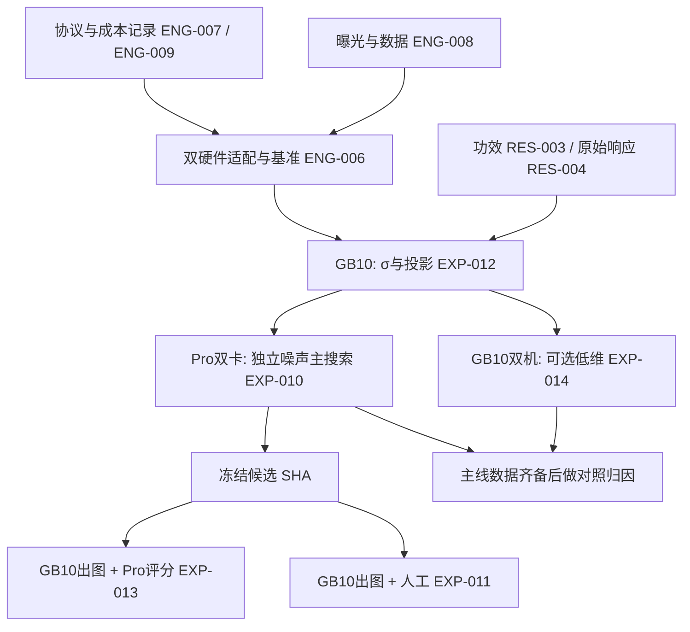

# EXP-009 后续：GB10 / Pro 6000 分工实验与票据索引

## 立项范围

2026-09-08 用户要求将 [EXP-009 review](../docs/exp009-review-20260908.html) 分别建票，并为 GB10 与 Pro 6000 估算计算需求，用异构并行缩短下一轮日历时间。本 Epic 新增 **11 张执行/研究票：9 项 review 各一票，外加硬件适配基准与可选低维对照**。本次只建票和做预算，没有执行 GPU 实验、启停云实例或改动现有 campaign。

继续遵守此前保留已有代码/文档的范围：本文件作为**新票索引**，既有 `tickets/README.md`、旧票据、说明页与 review 均不改写。票据状态采用旧 README 规范；`ready-for-agent` 表示已知文档依赖齐备，`blocked` 表示本轮前置票尚未完成。创建票不代表已领取或已批准其中所有待冻结实验参数。

硬件排程暂按仓库历史档案的 **2 台 GB10 + 2 张 RTX PRO 6000 Blackwell 96GB**；实际 Pro SKU、功率、主机 RAM 和实时可用性仍待 ENG-006 核实。各 GPU 票同时给单设备替代估算，换成单 Pro 不会悄悄改变实验样本量。与现有 EXP-009 的资源争用仅排队解决，不中断它。

## 新票图

| [ENG-006](ENG-006-mage-pro6000-runtime-parity-benchmark.md) | Mage 原生 NVFP4：GB10 / Pro 6000 适配与桥接基准 | blocked | F08, F09 | ENG-007, ENG-008, ENG-009 |
| [ENG-007](ENG-007-exp009-protocol-provenance-gates.md) | EXP-009 协议修订证据与下一轮门禁语义 | ready-for-agent | F05 | EXP-008 |
| [ENG-008](ENG-008-next-round-data-exposure-splits.md) | 下一轮样本曝光审计与独立确认数据 | ready-for-agent | F06 | ENG-003, EXP-008 |
| [ENG-009](ENG-009-experiment-compute-ledger.md) | 实验计算账本：参考、重放、教师前向与失败预算 | ready-for-agent | F09 | — |
| [RES-003](RES-003-es-statistical-power-stopping.md) | ES 统计功效、停止规则与最小有用增益设计 | done | F02 | EXP-008 |
| [RES-004](RES-004-es-raw-signal-penalty-diagnostics.md) | ES 原始方向响应、惩罚与 z-score 敏感性审计 | ready-for-agent | F08 | EXP-008 |
| [EXP-010](EXP-010-es-independent-noise-replication.md) | 独立噪声组的 ES 更新复现与外样本增益 | blocked | F01 | ENG-006, ENG-007, ENG-008, RES-003, RES-004, EXP-012 |
| [EXP-011](EXP-011-es-healed-direct-human-test.md) | ES final 对 raw healed 的直接人工盲测 | blocked | F03 | ENG-005, ENG-006, ENG-007, ENG-008, RES-003, EXP-010 |
| [EXP-012](EXP-012-es-sigma-projection-pilot.md) | healed master 起点投影与 σ 扰动尺度校准 | blocked | F04 | ENG-006, ENG-007, ENG-008, RES-003 |
| [EXP-013](EXP-013-es-fine-grained-heldout-evaluation.md) | ES 细粒度组合、文字与多 seed 留出验收 | blocked | F07 | ENG-006, ENG-007, ENG-008, RES-003, EXP-010 |
| [EXP-014](EXP-014-es-low-dimensional-budget-control.md) | 可选：低维 ES 与全维 ES 的等预算对照 | blocked | F01, F04, F08 | ENG-006, ENG-007, ENG-008, RES-003, EXP-012 |

## Review 到工作票的映射

| Review | 主要落实票 | 目标 |
|---|---|---|
| F01 固定 40 方向及独立重复 | EXP-010；可选 EXP-014 | 噪声组复现、低维效率对照 |
| F02 统计功效与结论边界 | RES-003 | 主终点、δ、层级区间、联合停止行为 |
| F03 人工缺少 raw healed 主对照 | EXP-011 | E 对 H 的直接盲测 |
| F04 σ 与起点投影 | EXP-012 | H/P 分解和实际扰动尺度 |
| F05 pilot 修订与门语义 | ENG-007 | 版本/曝光链及新协议真实条件 |
| F06 跨代/跨 campaign 曝光 | ENG-008 | 新 manifest 与独立确认池 |
| F07 组合/文字细粒度能力 | EXP-013 | 多 seed GenEval/OCR 与分轴 CI |
| F08 原始响应/惩罚/硬件混杂 | RES-004 + ENG-006 | 离线诊断与跨硬件桥接 |
| F09 计算账目 | ENG-009 | 图片、参考、重放、卡时和 IO 成本 |

## 统一估算口径

1. **同管线 GB10 锚点**：EXP-009 讲解快照约 3.2 h/梯度批。新 BF16 参考情况下每批生成调用数为 `(80 候选+1 中心+1 候选重放+2 BF16)×8=672`。`T_G=图片调用数/672×3.2 h`；约 17.1 s/图是整批摊销，并非裸图像推理延迟。来源：[review 预算核查](../docs/exp009-review-20260908.html#budget)。
2. **GB10 运行余量**：`[T_G,1.25T_G]`；双机在任务可分片时除以 `1.8`（90% 效率假设）。完整单 worker 基准和依赖阶段不能硬除以二。
3. **Pro 6000 未测**：展示端到端 **2×–4× 加速情景**，单卡 `[T_G/4,1.25T_G/2]`，双卡再除以 `1.7`（85% 效率假设）；它们不是置信区间或保证。另有 **1×退化情景**，单卡按 `1.25T_G`、双卡按 `1.25T_G/1.7`；兼容性/IO/RAM问题可能更差。
4. **设备小时与日历小时分开**：单卡设备小时与其占用墙钟相同；两卡的消耗按各卡运行小时加总，不能把除以并行因子后的时间当 GPUh。不同硬件的 GPUh 不直接当等价算力相加。表内显示墙钟；云实例整机按其实时报价和占用时间付费，单卡基准中的第二张闲卡也可能收费。
5. **特殊任务单独估**：纯统计/证据 0 GPUh；内容 gate 按文本条数；OCR/检测器按独立评分时长。不能将扩散生成的速度比直接套在这些工作上。
6. **资源与传输**：每 GB10 worker 暂留 80–100 GiB 统一内存；每 Pro worker 暂留 48–72 GiB VRAM、约 96 GiB host RAM，双 worker 主机 192–256 GiB。这是预算预留、不是已测最低值。主实验磁盘暂留 500 GB。首批约 70 GB 资产按 2/10/50 MB/s 约需 9.7/1.9/0.4 h，安装/编译 2–8 h 另列。96GB×2 不代表单进程 192GB 显存。
7. 所有数值须由 ENG-006 的同构完整 episode 与双 worker 计时替换，**未测前不承诺 2×–4× 必定成立**。NVIDIA 标称 sparse FLOPS/带宽及本仓库另一 LLM 任务的 4.6–5.7× 均只能作背景。

详细官方规格与来源：[共享硬件研究笔记](../docs/research/exp010-gb10-pro6000-hardware-estimates-20260908.md)。此处明确区分 GB10 CC12.1 与 Pro CC12.0；当前 Mage 入口与质量门硬编码 GB10，**必须完成 ENG-006 才能正式用 Pro 原生生成**。不要仅删除架构检查来伪装通过。

## GPU 工作量与硬件分配总表

下表仅含生成调用阶段，参考与重放已计入；安装、传输、人工、独立评分器和可选 crossover 另列在各票。

| 票 | 图片调用数 | 单 GB10 | 双 GB10 | 单 Pro，2×–4×情景 | 双 Pro，2×–4×情景 | 推荐位置 |
|---|---:|---:|---:|---:|---:|---|
| ENG-006 硬件基准 | 1,184/硬件类型；两类共 2,368 | 992 图单卡子集约4.7–5.9 h | 全包约4.6–7.1 h | 子集约1.2–3.0 h | 全包约1.4–4.0 h | 两类必须各做；不能整包按双卡除二 |
| EXP-012 σ/投影 | 2,176 | 10.4–13.0 h | **5.8–7.2 h** | 2.6–6.5 h | 1.5–3.8 h | GB10 |
| EXP-010 三噪声组完整上限 | 51,072 | 243.2–304.0 h | 135.1–168.9 h | 60.8–152.0 h | **35.8–89.4 h** | Pro 6000 |
| EXP-014 可选低维 | 17,024 参考上限 | 81.1–101.3 h | **45.0–56.3 h** | 20.3–50.7 h | 11.9–29.8 h | GB10，可与主搜索并行 |
| EXP-013 三臂多 seed 终检 | 1,440 | 6.9–8.6 h | **3.8–4.8 h** | 1.7–4.3 h | 1.0–2.5 h | GB10 生成，Pro 离线评分 |
| EXP-011 人工主对照出图 | 360 | 1.7–2.1 h | **1.0–1.2 h** | 0.4–1.1 h | 0.3–0.6 h | GB10 生成，CPU 标注服务 |

- ENG-008 内容门控最多 600 条另估单 GB10 0.5–1 h / 双 GB10 0.3–0.6 h；Pro单卡 0.13–0.5 h是未测情景。ENG-007/009、RES-003/004 均为 **0 新增 GPUh**，各票已列 CPU/人工占位。
- EXP-013 另留 Pro 检测器/OCR约0.5–2 GPUh（未测）；人工 EXP-011 约1.5–3.5总人时，评审排队不受GPU加速。
- EXP-014 另留主包10%的 crossover预算，见票；主线初始批准范围不自动扩大为多个低维版本或多轮追加搜索。
- **主线新生成上限合计57,416次**：ENG-006 2,368 + EXP-012 2,176 + EXP-010 51,072 + EXP-013 1,440 + EXP-011 360。加入可选 EXP-014 为74,440次，crossover尚需按实测另计；文本内容 gate 不算图片。

## 推荐分阶段排程

1. **准备期**：五张证据/数据/统计/计账票可按真实依赖并行准备；其中关键硬件适配票约1–3人日，其他票的人日分别列出；这是可并行任务的工作量，不是全部工程只需1–3人日。首次软件安装与资产迁移单列。仅建票不启动云实例。确认其是否仍有原服务与资源占用，执行时不能覆盖它们。
2. **硬件桥接**：两类硬件同时完成 ENG-006；墙钟取较慢 lane，而非两者相加。时间规划先留 **6–8 h GPU运行窗口**，另加安装与传输；测出真实加速比后更新后续所有表。
3. **尺度校准**：GB10 双机做 EXP-012，约 **5.8–7.2 h**。Pro 可同时完成环境验收、代码可行性检查及已落盘图片的评分准备，**不能在 σ/主协议未冻结前偷跑正式 EXP-010**。
4. **重计算期**：Pro 双卡跑 EXP-010 三噪声组完整上限，约 **35.8–89.4 h**。如启用可选低维，GB10 同时跑 EXP-014，约45–56 h另加crossover。两条线各自内配对，低维/全维的因果对照必须按票做同硬件crossover，不能让算法与硬件完全混杂。
5. **终检期**：主线候选在 selection后已固定，confirmation成功后才解封 final。GB10完成 EXP-013/011出图，若顺序使用双机共约 **4.8–6.0 h**；Pro可随完整prompt簇到达评分。人工到场另计。低维若尚未结束，在完整episode边界让出资源/排队，主线终检优先；不据主线结果改其算法。

在2×–4×加速情景、设备均已就绪、主线跑满且无可选低维资源等待时，GPU阶段约 **53–113小时（2.2–4.7天）**；软件研发、首次迁移、排队和人类评审另计。**这不是交付承诺**。若Pro实际仅1×速度，单是双Pro主搜索可达约178.8小时，主线整体可能超过8天；若只有一张Pro，其主搜索情景为60.8–152.0小时。ENG-006未完成前不能用乐观情景锁定租期。

## 审核与验收边界

- 每票都有可独立交付的范围、依赖、硬件工作量与验收项；多硬件加速不删去原生kernel、同硬件配对与重放证据。
- 当前状态是规划，未创建下一轮真实campaign。真正运行前冻结σ、α、样本用途、δ、噪声seed及预算；后续追加不能使用已解封test决定。
- GB10是原部署目标，Pro探索结论不能自动替换GB10验证；最终模型/clip身份跨票锁定。
- 云费用执行前按确切SKU/地区与实例报价计算；没有将5090历史价格套给Pro6000，也没有把0 GPUh的CPU票算成新增租卡需求。
- 所有旧文件保持原样，本Epic是新索引；完成票据时只更新相应新票与新证据。

## 证据

- 2026-09-08：用户要求分别建票并估算GB10/Pro6000资源；本次完成11张新票、此索引与共享硬件研究笔记。
- 当前没有新的GPU实测、科学结果或实时实例状态。硬件官方来源、历史基线与推算条件已分开标注。
